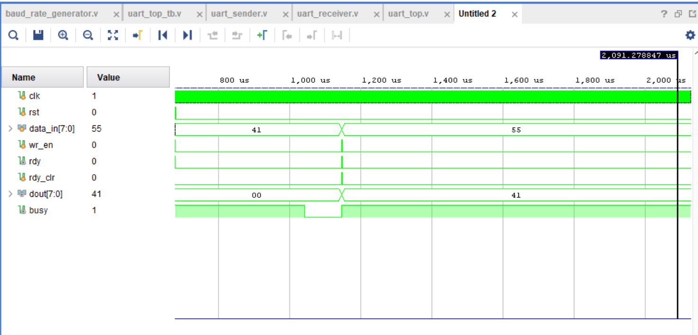

# UART Communication Using Verilog HDL

## About the Project

I implemented a UART (Universal Asynchronous Receiver/Transmitter) communication system using Verilog HDL. The project includes both transmitter and receiver modules for serial data communication. A baud-rate generator is used to provide the required timing for communication at a configured baud rate of 9600. The design was simulated using Xilinx Vivado to check its functionality.

## Modules

- `uart_top.v` – Connects the different modules and serves as the top-level module of the design.
- `baud_rate_generator.v` – Generates the timing signal required for UART communication.
- `uart_sender.v` – Converts parallel data into serial data for transmission.
- `uart_receiver.v` – Receives serial data and reconstructs the data for further use.
- `uart_top_tb.v` – Testbench used to simulate the design and observe its behavior.

## Tools Used

- **Verilog HDL:** Used to describe the digital logic and implement the UART modules.
- **Xilinx Vivado:** Used for RTL simulation and waveform analysis.
- **Testbench:** Used to apply input signals and observe the design's response during simulation.

## Simulation

The design was simulated in Vivado using a Verilog testbench. The simulation waveforms were observed to examine the behavior of the transmitter and receiver. The testbench was used to apply inputs and check the resulting signals. The configured baud rate for the design is 9600.

### Simulation Waveform

The waveform below shows the input and output data along with control signals such as `wr_en`, `rdy`, `rdy_clr`, and `busy` during simulation.

### Simulation Waveform

